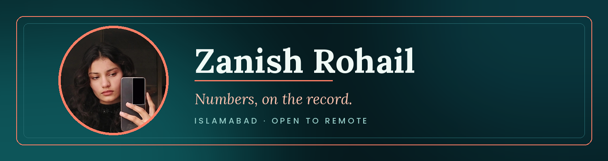

  

 

---

### 01 · About

I'm a data science student who turns messy, real-world data into decisions. Before that, I spent about a year as an Odoo developer building ERP modules in Python and Flask. I'm now focused on statistics, machine learning, and NLP, and I'm looking for remote data science roles.

---

### 02 · Stack

 

<b>01 · Languages</b> &nbsp;·&nbsp; click to expand

- **Python**: data analysis, ML, and backend work
- **SQL**: querying and data modelling
- **C++**: data structures and algorithms (current study)
- **JavaScript**: front-end work for Flask apps
- **Dart**: Flutter fitness app (learning)

<b>02 · Data & ML</b> &nbsp;·&nbsp; click to expand

- **Pandas and NumPy** for cleaning and analysis
- **Scikit-learn** for Logistic Regression and TF-IDF models
- **Statistics**: Welch's t-test and hypothesis testing
- **NLP**: text classification and vectorization

<b>03 · Web & Tools</b> &nbsp;·&nbsp; click to expand

- **Flask** web apps with Chart.js dashboards
- **Odoo ORM** for ERP modules and custom reports
- **PostgreSQL** for relational data
- **Git and GitHub** for version control
- **Docker** (learning)

 

---
### 04 · Contribution Snake

<picture>
  <source media="(prefers-color-scheme: dark)" srcset="dist/github-contribution-grid-snake-dark.svg" />
  
</picture>

---

### 05 · Currently

- Building a five-project data science portfolio
- Learning backend development and Docker
- Studying DSA in C++

---

*"Numbers are only useful when they lead to a decision."*

